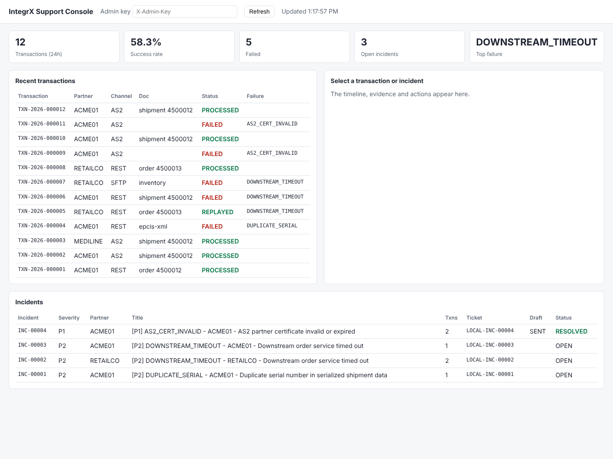
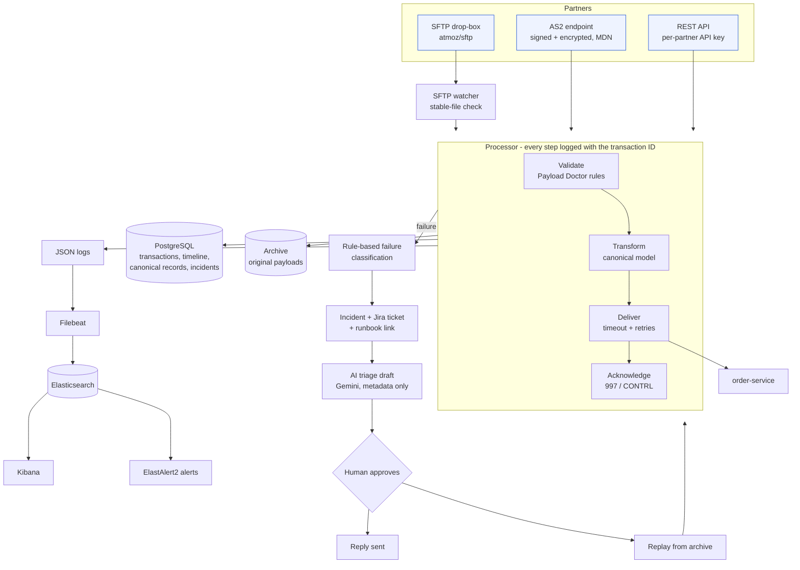

# IntegrX

**A B2B integration troubleshooting platform.** It receives XML (EPCIS), X12, EDIFACT and CSV transactions over **AS2, SFTP and REST**, normalises them into one **canonical model**, and traces every step of every transaction. When something breaks, it classifies the failure, opens an incident with a runbook, and drafts a customer reply for a human to approve. Once the cause is fixed, it replays the archived original.

IntegrX uses [Payload Doctor](https://github.com/hrushikapendharkar4241-droid/payload-doctor) as its validation and diagnosis engine.



## Why I built it

ShopPilot, my other project, serves textile manufacturers and wholesalers who exchange purchase orders, challans and e-way bills by hand. I wanted to learn how larger companies exchange these documents automatically between partners, and what a support team does when an exchange fails. The answer is mostly about the moment *after* something breaks:

1. A partner emails "the ASN never arrived".
2. The engineer finds the transaction.
3. They read its timeline and work out the cause.
4. They fix it, replay if that is safe, and reply.

IntegrX is built around that workflow.

## Architecture



## What it does

| Capability | How |
| --- | --- |
| **Intake** | **SFTP**: a watcher picks up files only after their size is stable across two polls, so half-uploaded files are never processed, and it recovers files stuck after a crash. **AS2**: real S/MIME signing and encryption via `pyas2lib`, with signed MDNs (synchronous or asynchronous). **REST**: a per-partner API key. |
| **Validation** | Payload Doctor's 70 rules for X12 850/856/997, EDIFACT ORDERS/DESADV/CONTRL, EPCIS 1.2 (serial numbers, packing hierarchy, lot/expiry, owning parties) and CSV |
| **Canonical model** | X12 850 and EDIFACT ORDERS become `order`; X12 856, EDIFACT DESADV and EPCIS become `shipment`; CSV becomes `inventory`; 997 and CONTRL become `ack` |
| **Delivery** | POST to the order service with a timeout, 2 retries on timeouts and 5xx (no retry on 4xx), and an `Idempotency-Key` header |
| **Acknowledgements** | Generates an accepted or rejected **997** (with AK3 pointing at the failing segment) or **CONTRL** for every EDI document, written to the outbox and the partner's SFTP `download/` folder. The generated 997s pass Payload Doctor cleanly (tested). |
| **Tracing** | Every step is stored as an event (API, console) and a JSON log line (Kibana, `pdoc trace`, `scripts/*.sh`) |
| **Classification** | 20 failure codes, each with a P1-P4 severity, a runbook, a customer-impact sentence, and a **replayable yes/no** flag |
| **Incidents** | Deduplicated: the same code for the same partner within 60 minutes forms one incident with many transactions. A Jira Cloud ticket is created through the REST API, or a Markdown ticket when Jira is not configured. |
| **Replay** | Re-runs the archived original as a new transaction linked by `replay_of`. A named approver and a reason are required. Refused when a replay cannot fix the failure (bad data, AS2 signatures that could not be verified). |
| **AI triage** | A Gemini free-tier draft of the diagnosis and the customer reply. Only error metadata is sent, never payload contents. Nothing is sent until a named engineer approves it. Falls back to a rule-based draft without a key or on any error. |
| **Fault injection** | `scripts/inject_fault.sh`: downstream timeout/500/401, AS2 certificate expiry, failed MDN delivery, failed ack writes, wrong SFTP password, bad payloads |
| **Operations** | Docker Compose, systemd units with hardening, cron or timer health checks, Bash tools for log analysis |

## Failure catalogue

| Code | Sev | Replay fixes it? | Runbook |
| --- | --- | --- | --- |
| `AS2_CERT_INVALID` | P1 | No: partner resends after the certificate exchange | [RB-01](runbooks/RB-01-as2-certificate-expiry.md) |
| `AS2_SECURITY_ERROR` | P2 | No | RB-01 |
| `AS2_MDN_NOT_DELIVERED` | P2 | No: the document was processed; a replay would duplicate it | [RB-02](runbooks/RB-02-missing-acknowledgement.md) |
| `ACK_NOT_SENT` | P3 | Resend the ack (`/resend-ack`) | RB-02 |
| `SFTP_AUTH_FAILURE` | P2 | No (nothing arrived) | [RB-03](runbooks/RB-03-sftp-authentication-failure.md) |
| `DUPLICATE_SERIAL`, `AGGREGATION_MISMATCH`, `PARTNER_REJECTED_ACK` | P2 | No: partner sends corrected data | [RB-04](runbooks/RB-04-payload-validation-failure.md) |
| `EPCIS_DATA_ERROR`, `INVALID_XML`, `EDI_ENVELOPE_ERROR`, `EDI_MAPPING_ERROR`, `CSV_DATA_ERROR`, `FILE_FORMAT_ERROR` | P3 | No | RB-04 |
| `TRANSFORM_ERROR` | P3 | Yes, after the mapping fix | RB-04 |
| `DOWNSTREAM_TIMEOUT`, `DOWNSTREAM_SERVER_ERROR`, `DOWNSTREAM_AUTH_FAILURE` | P2 | Yes, after the service is restored | [RB-05](runbooks/RB-05-downstream-timeout.md) |
| `DOWNSTREAM_REJECTED` | P3 | No | RB-05 |

## Quick start

Put both repositories side by side:

```text
workspace/
  payload-doctor/
  integrx/
```

The partner simulator, `pdoc` and the support scripts run on your own machine in both options, so install the Python packages first (Python 3.10+). On Windows, run the `.sh` scripts in WSL or Git Bash.

```bash
pip install -e ../payload-doctor -e ".[dev]"
```

### Option A: Docker (the full stack)

```bash
cd integrx
python scripts/setup_local.py                         # .env, folders, demo AS2 certificates
docker compose up -d --build                          # API, watcher, order-service, SFTP, PostgreSQL (~2 GB RAM)
docker compose --profile observability up -d          # + Elasticsearch, Kibana, Filebeat, ElastAlert2 (~4 GB more)
bash deploy/kibana/setup.sh                           # data view, saved searches and the "Integration health" dashboard
```

| Service | URL |
| --- | --- |
| Support console | http://localhost:8080/console (admin key from `.env`) |
| API docs (OpenAPI) | http://localhost:8080/docs |
| Kibana | http://localhost:5601 |
| SFTP | `sftp -P 2222 acme01@localhost` |

### Option B: no Docker (Python only, SQLite)

```bash
python scripts/setup_local.py
export INTEGRX_DOWNSTREAM_URL=http://localhost:8090/api/documents INTEGRX_DOWNSTREAM_TIMEOUT=3
uvicorn integrx.api:app --port 8080 &
uvicorn integrx.downstream_stub:app --port 8090 &
python -m integrx.sftp_watcher &          # drop files into data/sftp/<user>/upload/
```

### Send traffic and break things

```bash
python partner_sim/partners.py rest ACME01 ../payload-doctor/samples/good/po_850.edi
python partner_sim/partners.py as2  ACME01 ../payload-doctor/samples/good/asn_856.edi   # real AS2 + signed MDN
python scripts/generate_traffic.py --count 200 --bad-ratio 0.08                       # synthetic load
scripts/inject_fault.sh downstream-timeout                                            # then send more documents
python scripts/ticket_simulator.py                                                    # customer emails in data/tickets/inbox/
bash scripts/run_drills.sh                                                            # guided: reproduce + resolve 15 failures, with evidence
```

## The 3-minute demo

`scripts/demo.sh` walks through this story step by step:

1. **Normal traffic:** ACME01 sends an ASN over AS2 and gets back a signed MDN saying `processed`.
2. **Fault:** ACME01's certificate expires. The next ASN's MDN comes back `failed/Failure invalid-certificate`.
3. **Ticket:** "ASN never arrived". `scripts/analyze_transaction.sh` shows `AS2_CERT_INVALID` (P1), the evidence ("AS2-001: expired 1 day ago"), the impact and the runbook.
4. **Confirm:** `pdoc as2` on the certificate.
5. **Replay is refused on purpose:** a message whose signature failed verification is not trusted after the fact.
6. **Fix (RB-01):** renew and exchange the certificate. The partner resends, and the MDN says `processed`.
7. **Reply:** AI triage drafts the customer reply, Hrushika approves it, the reply is sent, and the incident is resolved.

## Support tools

```bash
scripts/analyze_transaction.sh TXN-2026-000005        # one-screen RCA: source, stages, error, severity, impact, runbook, timeline
scripts/find_errors.sh 2026-11-24 logs --summary      # errors by failure code and partner, list of failed transactions
scripts/health_check.sh                               # API, order-service, failures last hour, certificate expiry, disk
pdoc trace TXN-2026-000005 logs/                      # timeline straight from the JSON logs, even if the API is down
```

```text
Transaction:   TXN-2026-000005
Partner:       RETAILCO
Source:        REST   File: orders.edifact
Validation:    PASSED
Transform:     PASSED
Processing:    FAILED
Attempts:      3
Error:         ConnectionTimeout: 3s exceeded after 3 attempt(s)
RCA:           DOWNSTREAM_TIMEOUT (P2) - Downstream order service timed out
Replay fixes:  yes, after the cause is fixed
Runbook:       runbooks/RB-05-downstream-timeout.md
```

## API

| Method | Path | Purpose |
| --- | --- | --- |
| POST | `/api/v1/transactions` | REST intake (`X-Partner-ID`, `X-API-Key`, optional `X-Filename`) |
| POST | `/as2` | AS2 intake; returns a signed MDN |
| GET | `/api/v1/transactions?status=&partner=&business_key=` | Search |
| GET | `/api/v1/transactions/{id}` | Timeline, canonical document, classification, replays |
| GET | `/api/v1/transactions/{id}/payload` | Download the archived original |
| POST | `/api/v1/transactions/{id}/replay` | Replay with `approved_by` and `reason` |
| POST | `/api/v1/transactions/{id}/resend-ack` | Regenerate the 997/CONTRL |
| GET/POST | `/api/v1/incidents` | List, or open a manual incident (e.g. SFTP login problems) |
| POST | `/api/v1/incidents/{key}/triage`, `/approve`, `/send-reply`, `/resolve` | The governed AI workflow |
| GET | `/api/v1/stats`, `/api/v1/health` | Success rate, top failures, open incidents; health |
| GET/POST | `/api/v1/admin/faults` | In-process fault switches |

Support endpoints require `X-Admin-Key`.

## Jira, Confluence and Gemini (all free plans; optional)

- **Jira Cloud Free:** create a project with key `SUP`, create an API token at id.atlassian.com, then set `JIRA_BASE_URL`, `JIRA_EMAIL`, `JIRA_API_TOKEN` and `JIRA_PROJECT_KEY` in `.env`. Without these, tickets are written to `data/tickets/`.
- **Confluence Free:** paste each file in `runbooks/` as a page and set `CONFLUENCE_RUNBOOK_BASE` so ticket links point to it.
- **Gemini API free tier:** create a key in Google AI Studio and set `GEMINI_API_KEY`. Without it, triage drafts are rule-based.

If any of these asks for a payment card, stop: the project works fully without them.

## Tests

```bash
pip install -e ../payload-doctor -e ".[dev]"
pytest              # 25 tests: pipeline, real AS2 round trips, SFTP watcher, replay, governance, Jira/Gemini mocks, S3 (moto)
```

## What has been verified

Status as of 24 Nov 2026. Everything below was run on my own laptop (Windows 11, WSL2 Ubuntu, Docker Desktop) unless the "How" column says otherwise.

| Verified | How |
| --- | --- |
| Pipeline, acks, incidents, dedupe, replay, governance rules | 25 automated tests (`pytest`) |
| Full Docker Compose stack: PostgreSQL, API, SFTP watcher, order-service, SFTP server | `docker compose up -d --build`; API health `ok` |
| Real traffic on all three channels | REST (HTTP 202, `PROCESSED`), AS2 (signed + encrypted, **MDN processed**), SFTP (login + upload on port 2222, picked up by the watcher) |
| 997 / CONTRL acknowledgements | Written to `data/outbox/<partner>/` and the partner's SFTP `download/` folder |
| Observability stack: Elasticsearch, Filebeat, Kibana | `--profile observability`; failed transactions searchable by `txn_id` and `failure_code` in Discover |
| "IntegrX - Integration health" dashboard | 6 panels (transactions, failed, top failure types, errors over time, failures by partner, incidents), exported to `deploy/kibana/integration-health-dashboard.ndjson` |
| Real AS2 cryptography, expired-certificate rejection, async MDN | Tests plus live runs with the partner simulator |
| Jira and Gemini request shapes | Against mocks in the tests |

**In progress:** the 15 failure drills (`scripts/run_drills.sh`, evidence in `evidence/`), ElastAlert2 alert firing, and a live Jira Cloud project. This table will be updated as each one is verified.

## Limitations

- One process per role, with no message queue. A production version would put a queue (SQS, Kafka) between intake and processing, so a slow downstream never holds an intake connection.
- The S3 archive is supported (tested with `moto`), but the default is a local folder, because some local S3 emulators now need accounts.
- Demo credentials (SFTP passwords, API keys, AS2 key passphrase) are in config files for convenience. A real deployment needs a secrets manager.
- The X12 and EDIFACT coverage follows Payload Doctor's scope.

## Project layout

```text
src/integrx/
  api.py            HTTP API + console          pipeline.py      receive -> validate -> transform -> deliver -> ack
  as2_gateway.py    AS2 receive + MDNs          sftp_watcher.py  stable-file pickup, crash recovery
  canonical.py      format -> canonical model   classifier.py    failure codes, severity, runbook, replayable
  incidents.py      dedupe + Jira/offline ticket ai_triage.py    governed AI drafts
  acks.py           997 / CONTRL builders       downstream.py    timeout + retries
  db.py logs.py archive.py faults.py config.py downstream_stub.py
partner_sim/        partner simulator (REST, SFTP, AS2)
scripts/            analyze_transaction.sh, find_errors.sh, health_check.sh, inject_fault.sh, demo.sh, ...
deploy/             Dockerfile, filebeat, elastalert, kibana, systemd, cron, partners.json
runbooks/ postmortems/ handoff/ comms/
```

## License

MIT
